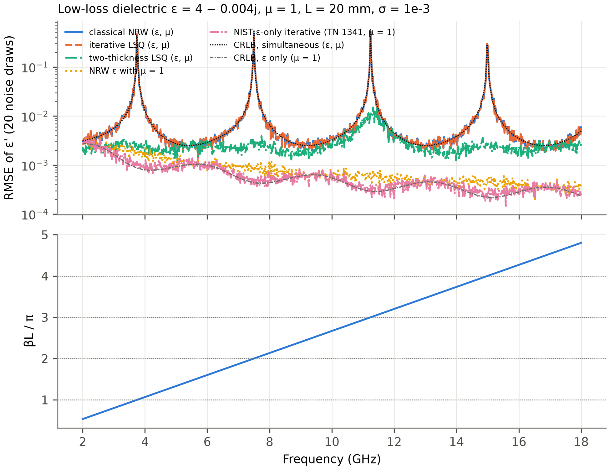
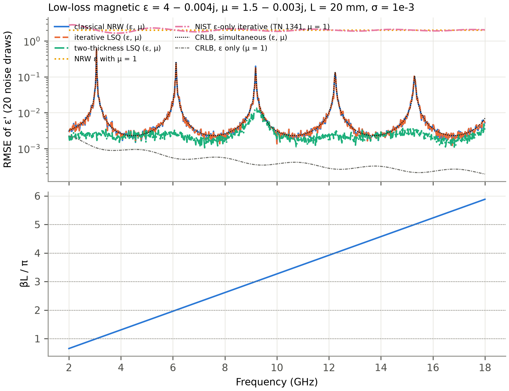
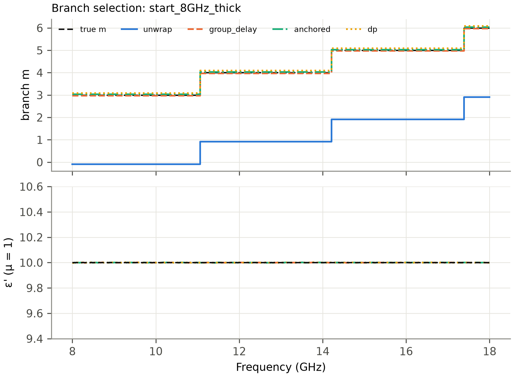
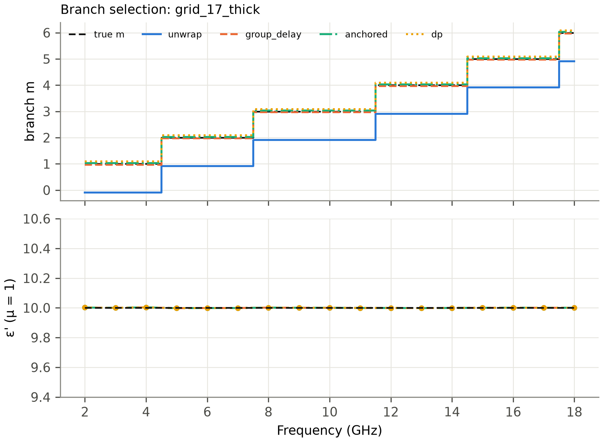
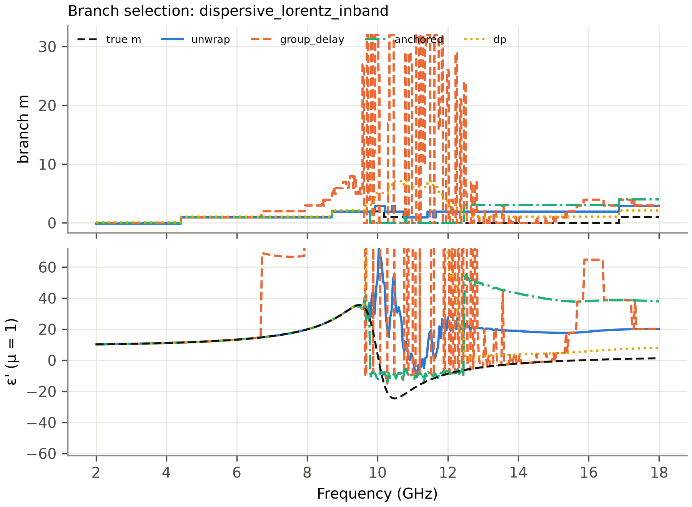
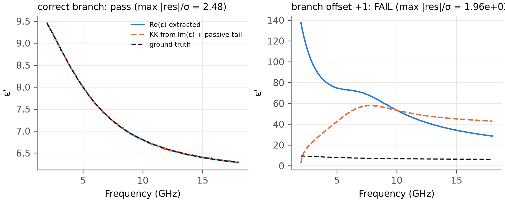
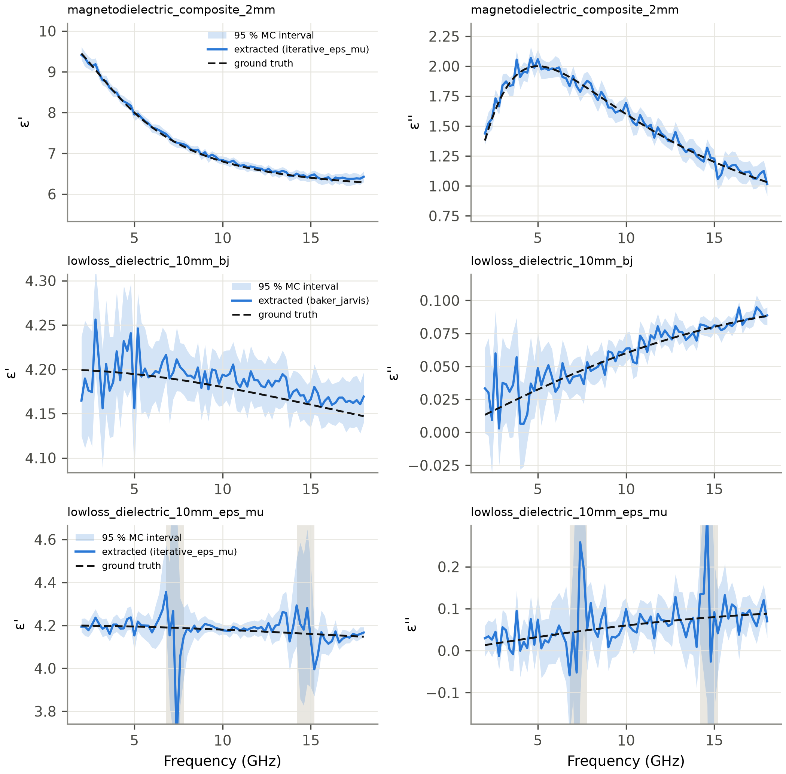

# Benchmark report

All numbers in this report come from experiments whose raw outputs are committed under
`results/`. Every table sits between `<!-- TABLE:… -->` markers and is regenerated from those
CSV files by `scripts/make_tables.py`. The prose quotes numbers from these tables and from the
study CSVs named in each section.

**All data are SYNTHETIC.** They were generated by the independent ABCD-cascade forward model
(`nrw.forward`), never by an inverse routine, in a 7 mm coaxial line (TEM), 2–18 GHz. Every
random draw is seeded. Environment: `results/benchmarks/environment.json`.

Contents:
1. Setup
2. Main benchmark: internal and external algorithms
3. Half-wavelength (NRW-singularity) study
4. Phase-branch study
5. NIST ε-only formulation study
6. Kramers–Kronig diagnostic: power and limits
7. Uncertainty (Monte Carlo) coverage
8. External implementations: findings
9. Comparative assessment and final selection
10. Limitations of this benchmark

---

## 1. Setup

**Cases** (`scripts/benchlib.py::CASES`):

| case | ε model | μ model | L |
|---|---|---|---|
| lowloss_dielectric | Debye(4.0, Δ = 0.2, 30 GHz) | 1 | 10 mm |
| highloss_dielectric | Debye(20, 30, 3 GHz) | 1 | 3 mm |
| debye_dielectric | Debye(3, 7, 5 GHz) | 1 | 5 mm |
| lorentz_dielectric | Lorentz(4, 1.5, 12 GHz, γ = 2 GHz) | 1 | 4 mm |
| magnetic_lorentz | Debye(8, 0.5, 40 GHz) | Lorentz(1, 3, 5 GHz, 4 GHz) | 2 mm |
| magnetodielectric_composite | Debye(6, 4, 5 GHz) | Lorentz(1, 2.5, 4 GHz, 6 GHz) | 2 mm |
| near_unity | Debye(1.10, 0.05, 20 GHz) | Lorentz(1, 0.03, 25 GHz, 10 GHz) | 5 mm |
| very_lossy_magnetic | Debye(15, 20, 2 GHz) | Lorentz(1, 5, 2 GHz, 5 GHz) | 3 mm |
| thin_dielectric | Debye(4, 0.2, 30 GHz) | 1 | 0.3 mm |
| thick_dielectric | Debye(10, 0.5, 30 GHz) | 1 | 30 mm |
| lowloss_magnetodielectric_thick | Debye(6, 0.1, 50 GHz) | Lorentz(1, 0.5, 30 GHz, 10 GHz) | 10 mm |

**Scenarios** (`scripts/benchlib.py::make_dataset`). Stochastic scenarios use 5 seeds for
internal algorithms and 3 for external ones:
* noise: `noise_free`; circular complex Gaussian noise `noise_1e-3`, `noise_3e-3`,
  `noise_1e-2`; `mag_noise` (0.5 % relative); `phase_noise` (0.5°);
* reference planes and geometry: `ref_plane_error` (50 µm uncorrected shift at port 1);
  `thickness_error` (L assumed 1 % too long);
* frequency grid: `coarse_grid` (33 points); `missing_freq` (30 % random points removed plus
  an 8–10 GHz hole); `high_start` (8–18 GHz);
* fixture: `air_gap` (10 µm radial gaps at both conductors, capacitor model); `holder_mismatch`
  (51 Ω holder, 50 Ω calibration); `fixture_loss` (5 mm lossy line sections de-embedded as
  lossless).

**Metrics** (`scripts/benchlib.py::metrics`):
* RMSE of ε′, ε″, μ′, μ″ and the median relative error of ε and μ;
* **failure rate**: the fraction of frequencies with |Δε|/|ε| > 10 %, |Δμ|/|μ| > 10 %, or a
  non-finite value;
* **branch error rate**: the fraction of frequencies whose branch index differs from the true
  one (internal methods only; external codes do not expose m);
* **passivity violations**: points with ε″ or μ″ below −3× the Cramér–Rao σ at the scenario
  noise level;
* non-finite values, crashes, and runtime.

**Algorithms.**

*Internal* (`scripts/benchlib.py::INTERNAL`):

| name | method | branch |
|---|---|---|
| `nrw_principal` | textbook NRW | m = 0 |
| `nrw_unwrap` | NRW | unwrap from f_min with m = 0 |
| `nrw_groupdelay` | NRW | Weir pointwise group delay |
| `nrw_anchored` | NRW | anchored segments |
| `nrw_dp` | NRW | dynamic programming |
| `nrw_eps_mu1` | Boughriet/NRW μ = 1 | anchored |
| `bj_eps_iterative` | NIST TN 1341 eqs. (2.24)+(2.25), μ = 1 | anchored |
| `iterative_eps_mu` | pointwise (ε, μ) LSQ on four S-parameters | anchored |
| `regularized_eps_mu` | Tikhonov, λ = 1 | anchored |

*External* (`ext:*`): the adapters of `research/adapters/`, calling the third-party code at
the pinned commits (`docs/github_survey.md`).

---

## 2. Main benchmark

### 2.1 Fair comparison on the scenario set shared by all algorithms

The shared set is: noise_free, noise 1e-3 and 1e-2, thickness_error, coarse_grid,
high_start, missing_freq, ref_plane_error, with seeds 0–2.

**Non-magnetic cases:**

<!-- TABLE:alg_nonmagnetic -->
| algorithm | mu = 1 assumed | runs | median rel. err ε | median rel. err μ | mean failure rate | runs with failures | mean branch error rate | passivity viol. (>3σ CRLB) | non-finite values | crashed runs | median runtime (s) |
|---|---|---|---|---|---|---|---|---|---|---|---|
| regularized_eps_mu | no | 84 | 0.00143 | 0.0014 | 0.0349 | 0.202 | 0.00125 | 1152 | 0 | 0 | 1.99 |
| iterative_eps_mu | no | 84 | 0.00143 | 0.0014 | 0.04 | 0.262 | 0.00125 | 1161 | 0 | 0 | 0.344 |
| nrw_anchored | no | 84 | 0.00143 | 0.0014 | 0.04 | 0.262 | 0.00125 | 1161 | 0 | 0 | 0.0754 |
| nrw_dp | no | 84 | 0.00143 | 0.0014 | 0.0547 | 0.274 | 0.0165 | 1189 | 0 | 0 | 0.301 |
| nrw_groupdelay | no | 84 | 0.00145 | 0.00148 | 0.0779 | 0.452 | 0.0396 | 1900 | 0 | 0 | 0.00903 |
| nrw_unwrap | no | 84 | 0.00334 | 0.00906 | 0.217 | 0.369 | 0.179 | 1075 | 0 | 0 | 0.00792 |
| ext:shikouzhong_nrw | no | 84 | 0.00334 | 0.00905 | 0.217 | 0.405 | – | 1140 | 0 | 0 | 3.11 |
| ext:bj_tem_5g | no | 84 | 0.00589 | 0.00905 | 0.219 | 0.369 | – | 1112 | 0 | 0 | 2.07 |
| ext:scatter_opt_nrw | no | 84 | 0.00487 | 0.0099 | 0.227 | 0.417 | – | 2166 | 0 | 0 | 3.72 |
| ext:onlyee_method2 | no | 84 | 0.00493 | 0.00922 | 0.231 | 0.417 | – | 2160 | 0 | 0 | 0.00103 |
| ext:kasbrot_nrw | no | 84 | 0.00559 | 0.00664 | 0.316 | 0.631 | – | 9053 | 0 | 0 | 0.0334 |
| nrw_principal | no | 84 | 0.0187 | 0.0167 | 0.434 | 0.762 | 0.398 | 659 | 0 | 0 | 0.00389 |
| ext:njchorda_nrw | no | 84 | 0.0267 | 0.0241 | 0.44 | 0.786 | – | 6863 | 0 | 0 | 2.79 |
| ext:sparam_inversion_nrw | no | 84 | 0.0267 | 0.0241 | 0.443 | 0.786 | – | 1198 | 0 | 0 | 0.0145 |
| ext:meep_retrieval | no | 84 | 0.0267 | 0.0241 | 0.443 | 0.786 | – | 1198 | 0 | 0 | 0.0222 |
| ext:permittivitycalc_nrw | no | 84 | 0.308 | 0.309 | 0.646 | 0.821 | – | 1871 | 0 | 0 | 0.0589 |
| ext:scatter_opt_gd | no | 84 | 2.57 | 2.58 | 0.688 | 0.786 | – | 16208 | 0 | 0 | 4.01 |
| bj_eps_iterative | yes | 84 | 5.31e-04 | 0 | 0.00591 | 0.0357 | 0.00125 | 12 | 0 | 0 | 0.474 |
| nrw_eps_mu1 | yes | 84 | 8.07e-04 | 0 | 0.0356 | 0.0833 | 0.00125 | 310 | 0 | 0 | 0.076 |
| ext:onlyee_method1 | yes | 84 | 0.00421 | 0 | 0.211 | 0.393 | – | 783 | 0 | 0 | 4.23e-04 |
| ext:permittivitycalc_nni | yes | 84 | 0.00396 | 0 | 0.214 | 0.262 | – | 597 | 0 | 0 | 0.0343 |
| ext:ermakov_wg | yes | 84 | 0.00563 | 0 | 0.221 | 0.357 | – | 783 | 0 | 0 | 1.79 |
| ext:atom711_nrw | yes | 84 | 0.00564 | 0 | 0.221 | 0.357 | – | 783 | 0 | 0 | 0.00376 |
| ext:musho_cpp | yes | 84 | 2.68 | 0 | 0.988 | 1 | – | 7056 | 0 | 0 | 0.301 |
<!-- /TABLE:alg_nonmagnetic -->

**Magnetic cases.** Methods that assume μ = 1 are *expected* to fail here; they are listed
for completeness.

<!-- TABLE:alg_magnetic -->
| algorithm | mu = 1 assumed | runs | median rel. err ε | median rel. err μ | mean failure rate | runs with failures | mean branch error rate | passivity viol. (>3σ CRLB) | non-finite values | crashed runs | median runtime (s) |
|---|---|---|---|---|---|---|---|---|---|---|---|
| regularized_eps_mu | no | 70 | 0.0011 | 0.00132 | 6.06e-04 | 0.143 | 5.34e-04 | 56 | 0 | 0 | 1.47 |
| nrw_anchored | no | 70 | 0.0011 | 0.00132 | 0.0021 | 0.186 | 5.34e-04 | 56 | 0 | 0 | 0.0582 |
| nrw_dp | no | 70 | 0.0011 | 0.00132 | 0.0021 | 0.186 | 5.34e-04 | 56 | 0 | 0 | 0.23 |
| iterative_eps_mu | no | 70 | 0.0011 | 0.00132 | 0.0021 | 0.186 | 5.34e-04 | 56 | 0 | 0 | 0.308 |
| nrw_unwrap | no | 70 | 0.00111 | 0.00171 | 0.0164 | 0.2 | 0.0148 | 56 | 0 | 0 | 0.00883 |
| ext:bj_tem_5g | no | 70 | 0.00145 | 0.00188 | 0.0166 | 0.243 | – | 61 | 0 | 0 | 1.87 |
| nrw_groupdelay | no | 70 | 0.0011 | 0.00132 | 0.0229 | 0.229 | 0.0215 | 365 | 0 | 0 | 0.0117 |
| ext:scatter_opt_nrw | no | 70 | 0.0016 | 0.00248 | 0.0259 | 0.257 | – | 238 | 0 | 0 | 3.24 |
| ext:onlyee_method2 | no | 70 | 0.00175 | 0.00307 | 0.0402 | 0.271 | – | 696 | 0 | 0 | 9.65e-04 |
| ext:shikouzhong_nrw | no | 70 | 0.00111 | 0.00193 | 0.0613 | 0.329 | – | 100 | 0 | 0 | 2.7 |
| ext:kasbrot_nrw | no | 70 | 0.00264 | 0.00551 | 0.217 | 0.571 | – | 5214 | 0 | 0 | 0.0238 |
| nrw_principal | no | 70 | 0.00344 | 0.00389 | 0.228 | 0.486 | 0.227 | 39 | 0 | 0 | 0.00326 |
| ext:njchorda_nrw | no | 70 | 0.00475 | 0.00554 | 0.232 | 0.529 | – | 3544 | 0 | 0 | 2.13 |
| ext:meep_retrieval | no | 70 | 0.00475 | 0.00554 | 0.235 | 0.529 | – | 98 | 0 | 0 | 0.0444 |
| ext:sparam_inversion_nrw | no | 70 | 0.00475 | 0.00554 | 0.235 | 0.529 | – | 98 | 0 | 0 | 0.00332 |
| ext:permittivitycalc_nrw | no | 70 | 0.117 | 0.116 | 0.516 | 0.8 | – | 102 | 0 | 0 | 0.0594 |
| ext:scatter_opt_gd | no | 70 | 5.31 | 5.29 | 0.729 | 0.743 | – | 14509 | 0 | 0 | 4.4 |
| bj_eps_iterative | yes | 70 | 0.244 | 0.359 | 0.753 | 0.843 | 5.34e-04 | 462 | 0 | 0 | 0.514 |
| ext:permittivitycalc_nni | yes | 70 | 0.386 | 0.359 | 0.754 | 0.843 | – | 47 | 0 | 0 | 0.0594 |
| nrw_eps_mu1 | yes | 70 | 0.386 | 0.359 | 0.754 | 0.843 | 5.34e-04 | 4 | 0 | 0 | 0.0472 |
| ext:onlyee_method1 | yes | 70 | 0.386 | 0.359 | 0.755 | 0.843 | – | 212 | 0 | 0 | 4.75e-04 |
| ext:ermakov_wg | yes | 70 | 0.386 | 0.359 | 0.755 | 0.843 | – | 57 | 0 | 0 | 2.15 |
| ext:atom711_nrw | yes | 70 | 0.386 | 0.359 | 0.755 | 0.843 | – | 57 | 0 | 0 | 0.00182 |
| ext:musho_cpp | yes | 70 | 1.37 | 0.359 | 1 | 1 | – | 3802 | 0 | 0 | 0.276 |
<!-- /TABLE:alg_magnetic -->

**Reading the tables.**

*Non-magnetic cases.*
* The NIST ε-only iterative method (`bj_eps_iterative`) is clearly best: mean failure rate
  0.0059, median relative error 5.3e-4.
* All simultaneous (ε, μ) methods with a vetted branch sit at ≈ 0.04. Their failures are the
  half-wave spikes of the low-loss and thick samples (§3) plus the uncorrected plane error.
* Plain unwrapping reaches 0.217 and the textbook m = 0 NRW 0.434.

*Magnetic cases.* The anchored-branch simultaneous methods are best:
* NRW, DP tracking and iterative LSQ: 0.0021;
* the Tikhonov-regularised variant: 6.1e-4, which comes at the price of a smoothness
  assumption.

Every μ = 1 method, internal or external, fails on magnetic samples (≈ 0.75), as expected.

**External codes.**
* The best is `bj_tem_5g` (TN 1355-R invariant closed form), with failure rates 0.0166
  (magnetic) and 0.219 (non-magnetic).
* It matches, but does not beat, our plain `nrw_unwrap` baseline (0.0164 / 0.217). The
  shared weakness is that the branch at the lowest frequency is assumed to be m = 0.
* Codes without any branch handling (`njchorda_nrw`, `sparam_inversion_nrw`,
  `meep_retrieval`) behave like textbook NRW (≈ 0.23 / 0.44).
* `permittivitycalc_nrw` (0.52 / 0.65) and `scatter_opt_gd` (0.73 / 0.69) are worse than
  textbook NRW; see §8 for the defects.
* No external code crashed or produced non-finite values on these inputs.

The passivity column counts points with loss below −3σ of the CRLB for *additive* noise of
the scenario level. For systematic-error scenarios, this measures how strongly the error
drives the loss negative.

### 2.2 Internal algorithms: failure rate by scenario (all 14 scenarios, 5 seeds)

<!-- TABLE:internal_by_scenario -->
| algorithm | air_gap | coarse_grid | fixture_loss | high_start | holder_mismatch | mag_noise | missing_freq | noise_1e-2 | noise_1e-3 | noise_3e-3 | noise_free | phase_noise | ref_plane_error | thickness_error |
|---|---|---|---|---|---|---|---|---|---|---|---|---|---|---|
| bj_eps_iterative | 0.46 | 0.344 | 0.344 | 0.332 | 0.344 | 0.348 | 0.342 | 0.359 | 0.344 | 0.344 | 0.344 | 0.356 | 0.344 | 0.344 |
| iterative_eps_mu | 0.187 | 0 | 0 | 0 | 0 | 0.017 | 0 | 0.0745 | 8.00e-04 | 0.013 | 0 | 0.0367 | 0.0982 | 0 |
| nrw_anchored | 0.187 | 0 | 0 | 0 | 0 | 0.017 | 0 | 0.0745 | 8.00e-04 | 0.013 | 0 | 0.0367 | 0.0982 | 0 |
| nrw_dp | 0.187 | 0.0358 | 0 | 0 | 0 | 0.017 | 0 | 0.104 | 8.00e-04 | 0.013 | 0 | 0.0367 | 0.0982 | 0 |
| nrw_eps_mu1 | 0.46 | 0.344 | 0.344 | 0.332 | 0.344 | 0.365 | 0.342 | 0.405 | 0.344 | 0.356 | 0.344 | 0.385 | 0.435 | 0.348 |
| nrw_groupdelay | 0.194 | 0.0055 | 0.0079 | 0.0127 | 0.0079 | 0.025 | 0.0084 | 0.186 | 0.0089 | 0.025 | 0.0079 | 0.0999 | 0.106 | 0.0079 |
| nrw_principal | 0.426 | 0.314 | 0.312 | 0.41 | 0.312 | 0.328 | 0.314 | 0.377 | 0.312 | 0.324 | 0.312 | 0.346 | 0.406 | 0.312 |
| nrw_unwrap | 0.278 | 0.0909 | 0.0909 | 0.273 | 0.0909 | 0.107 | 0.0909 | 0.161 | 0.0915 | 0.104 | 0.0909 | 0.126 | 0.187 | 0.0909 |
| regularized_eps_mu | 0.187 | 0 | 0 | 0 | 0 | 0.0167 | 0 | 0.0588 | 5.00e-04 | 0.011 | 0 | 0.036 | 0.0977 | 0 |
<!-- /TABLE:internal_by_scenario -->

* **Systematic errors dominate once the branch is right.**
  * `air_gap` (10 µm radial gaps) gives 0.187 for every simultaneous method. The extracted
    values are the *effective* parameters of the gapped line, and no inversion algorithm can
    correct this without a gap model (theory §9.2).
  * `ref_plane_error` (50 µm) gives 0.098.
  * `thickness_error` (1 %) does not produce >10 % failures. It biases ε′ by 1.8–2.0 % for
    μ = 1 retrieval (`thickness_error` rows of `raw.csv`).
* **Noise.**
  * At σ = 1e-2 the anchored tracker gives 0.074; regularisation 0.059; DP 0.104; Weir's
    pointwise group delay 0.186.
  * Phase noise (0.5°) gives 0.037.
* **Frequency grid.**
  * `high_start` (8–18 GHz) breaks plain unwrapping (0.273) but not the anchored tracker (0).
  * On the 33-point grid the anchored tracker stays at 0 while DP reaches 0.036. The DP
    continuity weight penalises the large εμ change per step of the dispersive magnetic
    cases.
* **μ = 1 methods.** Their constant ≈ 0.34 comes from the five magnetic cases, where μ = 1
  is false. On non-magnetic cases alone they are the most accurate methods (§2.1).

### 2.3 Internal algorithms: failure rate by case

Magnetic cases:

<!-- TABLE:internal_by_case_magnetic -->
| algorithm | lowloss_magnetodielectric_thick | magnetic_lorentz | magnetodielectric_composite | near_unity | very_lossy_magnetic |
|---|---|---|---|---|---|
| bj_eps_iterative | 1 | 1 | 1 | 7.00e-04 | 0.78 |
| iterative_eps_mu | 0.0045 | 9.00e-04 | 4.00e-04 | 1.00e-04 | 0.0285 |
| nrw_anchored | 0.0045 | 9.00e-04 | 4.00e-04 | 1.00e-04 | 0.0285 |
| nrw_dp | 0.0045 | 9.00e-04 | 4.00e-04 | 1.00e-04 | 0.0285 |
| nrw_eps_mu1 | 1 | 1 | 1 | 0.0016 | 0.782 |
| nrw_groupdelay | 0.0261 | 0.0274 | 0.0121 | 0.0026 | 0.0697 |
| nrw_principal | 0.818 | 9.00e-04 | 4.00e-04 | 1.00e-04 | 0.32 |
| nrw_unwrap | 0.0308 | 9.00e-04 | 4.00e-04 | 1.00e-04 | 0.0285 |
| regularized_eps_mu | 0.001 | 9.00e-04 | 2.00e-04 | 1.00e-04 | 0.0266 |
<!-- /TABLE:internal_by_case_magnetic -->

Non-magnetic cases:

<!-- TABLE:internal_by_case_nonmagnetic -->
| algorithm | debye_dielectric | highloss_dielectric | lorentz_dielectric | lowloss_dielectric | thick_dielectric | thin_dielectric |
|---|---|---|---|---|---|---|
| bj_eps_iterative | 0 | 0.0263 | 0.0014 | 0 | 0 | 0.0465 |
| iterative_eps_mu | 1.00e-04 | 0.0279 | 0.0016 | 0.0114 | 0.0096 | 0.203 |
| nrw_anchored | 1.00e-04 | 0.0279 | 0.0016 | 0.0114 | 0.0096 | 0.203 |
| nrw_dp | 1.00e-04 | 0.0708 | 0.0119 | 0.0114 | 0.0096 | 0.203 |
| nrw_eps_mu1 | 1.00e-04 | 0.0264 | 0.0015 | 0 | 0 | 0.223 |
| nrw_groupdelay | 0.0198 | 0.0837 | 0.106 | 0.0214 | 0.0375 | 0.207 |
| nrw_principal | 0.19 | 0.504 | 0.0016 | 0.671 | 1 | 0.203 |
| nrw_unwrap | 1.00e-04 | 0.0279 | 0.0016 | 0.0377 | 1 | 0.203 |
| regularized_eps_mu | 1.00e-04 | 0.0266 | 0.0016 | 0.0074 | 0.0029 | 0.193 |
<!-- /TABLE:internal_by_case_nonmagnetic -->

### 2.4 Median RMSE per case (all scenarios)

<!-- TABLE:rmse_by_case -->
| algorithm | case | rmse_eps_real | rmse_eps_loss | rmse_mu_real | rmse_mu_loss |
|---|---|---|---|---|---|
| bj_eps_iterative | debye_dielectric | 0.0148 | 0.0193 | 0 | 0 |
| bj_eps_iterative | highloss_dielectric | 0.106 | 0.11 | 0 | 0 |
| bj_eps_iterative | lorentz_dielectric | 0.0147 | 0.0178 | 0 | 0 |
| bj_eps_iterative | lowloss_dielectric | 0.00334 | 0.0018 | 0 | 0 |
| bj_eps_iterative | lowloss_magnetodielectric_thick | 3.64 | 0.563 | 0.574 | 0.101 |
| bj_eps_iterative | magnetic_lorentz | 2.81 | 2.96 | 1.26 | 1.64 |
| bj_eps_iterative | magnetodielectric_composite | 1.02 | 1.24 | 0.434 | 0.831 |
| bj_eps_iterative | near_unity | 0.04 | 0.0138 | 0.0361 | 0.0112 |
| bj_eps_iterative | thick_dielectric | 0.00218 | 0.00184 | 0 | 0 |
| bj_eps_iterative | thin_dielectric | 0.0395 | 0.0251 | 0 | 0 |
| bj_eps_iterative | very_lossy_magnetic | 3.65 | 1.5 | 0.236 | 0.509 |
| iterative_eps_mu | debye_dielectric | 0.0209 | 0.0204 | 0.00361 | 0.00336 |
| iterative_eps_mu | highloss_dielectric | 0.181 | 0.104 | 0.00788 | 0.00577 |
| iterative_eps_mu | lorentz_dielectric | 0.0262 | 0.0253 | 0.00434 | 0.00448 |
| iterative_eps_mu | lowloss_dielectric | 0.0433 | 0.0462 | 0.00962 | 0.0108 |
| iterative_eps_mu | lowloss_magnetodielectric_thick | 0.0403 | 0.0352 | 0.00994 | 0.00869 |
| iterative_eps_mu | magnetic_lorentz | 0.025 | 0.0227 | 0.0101 | 0.0117 |
| iterative_eps_mu | magnetodielectric_composite | 0.0222 | 0.0196 | 0.00776 | 0.00954 |
| iterative_eps_mu | near_unity | 0.00153 | 0.00116 | 0.00122 | 0.00114 |
| iterative_eps_mu | thick_dielectric | 0.113 | 0.105 | 0.00977 | 0.00996 |
| iterative_eps_mu | thin_dielectric | 0.0306 | 0.0174 | 0.019 | 0.0178 |
| iterative_eps_mu | very_lossy_magnetic | 0.123 | 0.0753 | 0.00773 | 0.00724 |
| nrw_anchored | debye_dielectric | 0.0209 | 0.0204 | 0.00361 | 0.00336 |
| nrw_anchored | highloss_dielectric | 0.181 | 0.104 | 0.00788 | 0.00577 |
| nrw_anchored | lorentz_dielectric | 0.0262 | 0.0253 | 0.00434 | 0.00448 |
| nrw_anchored | lowloss_dielectric | 0.0433 | 0.0462 | 0.00962 | 0.0108 |
| nrw_anchored | lowloss_magnetodielectric_thick | 0.0403 | 0.0352 | 0.00994 | 0.00869 |
| nrw_anchored | magnetic_lorentz | 0.025 | 0.0227 | 0.0101 | 0.0117 |
| nrw_anchored | magnetodielectric_composite | 0.0222 | 0.0196 | 0.00776 | 0.00954 |
| nrw_anchored | near_unity | 0.00153 | 0.00116 | 0.00122 | 0.00114 |
| nrw_anchored | thick_dielectric | 0.113 | 0.105 | 0.00977 | 0.00996 |
| nrw_anchored | thin_dielectric | 0.0306 | 0.0174 | 0.019 | 0.0178 |
| nrw_anchored | very_lossy_magnetic | 0.123 | 0.0753 | 0.00773 | 0.00724 |
| regularized_eps_mu | debye_dielectric | 0.0208 | 0.0203 | 0.00361 | 0.00336 |
| regularized_eps_mu | highloss_dielectric | 0.155 | 0.0985 | 0.00669 | 0.00572 |
| regularized_eps_mu | lorentz_dielectric | 0.0255 | 0.0248 | 0.00432 | 0.00445 |
| regularized_eps_mu | lowloss_dielectric | 0.0349 | 0.0383 | 0.0084 | 0.00941 |
| regularized_eps_mu | lowloss_magnetodielectric_thick | 0.0352 | 0.0331 | 0.00851 | 0.00817 |
| regularized_eps_mu | magnetic_lorentz | 0.0249 | 0.0227 | 0.01 | 0.0116 |
| regularized_eps_mu | magnetodielectric_composite | 0.0221 | 0.0196 | 0.00776 | 0.00953 |
| regularized_eps_mu | near_unity | 0.00153 | 0.00116 | 0.00122 | 0.00114 |
| regularized_eps_mu | thick_dielectric | 0.0822 | 0.0778 | 0.0077 | 0.00742 |
| regularized_eps_mu | thin_dielectric | 0.0304 | 0.0172 | 0.0187 | 0.0177 |
| regularized_eps_mu | very_lossy_magnetic | 0.11 | 0.0733 | 0.00743 | 0.0072 |
<!-- /TABLE:rmse_by_case -->

---

## 3. Half-wavelength (NRW-singularity) study

`scripts/study_singularity.py`. Setup:
* ε = 4 − 0.004j; μ = 1 (dielectric) or μ = 1.5 − 0.003j (magnetic);
* L = 20 mm (second length 13 mm); σ = 10⁻³; 801 points; 20 noise draws;
* "near half-wave" means |βL/π − k| < 0.05 with k ≥ 1.

<!-- TABLE:singularity -->
| study | algorithm | rmse_eps_real_all | rmse_eps_real_near_halfwave | rmse_eps_real_away | max_abs_err_eps | rmse_mu_real_all | max_abs_err_mu |
|---|---|---|---|---|---|---|---|
| dielectric | nrw | 0.0401 | 0.131 | 0.00596 | 2.17 | 0.0105 | 0.436 |
| dielectric | iter_eps_mu | 0.0401 | 0.131 | 0.00596 | 2.17 | 0.0105 | 0.436 |
| dielectric | nrw_eps_mu1 | 0.00108 | 0.0011 | 0.00108 | 0.011 | 0 | 0 |
| dielectric | bj_eps | 8.86e-04 | 5.94e-04 | 9.11e-04 | 0.0108 | 0 | 0 |
| dielectric | two_thickness | 0.00322 | 0.00581 | 0.00282 | 0.0352 | 7.95e-04 | 0.00898 |
| dielectric | CRLB_eps_mu | 0.0416 | 0.136 | 0.00594 | – | – | – |
| dielectric | CRLB_eps_only | 8.33e-04 | 5.24e-04 | 8.59e-04 | – | – | – |
| magnetic | nrw | 0.029 | 0.0933 | 0.00522 | 1.65 | 0.0104 | 0.566 |
| magnetic | iter_eps_mu | 0.029 | 0.0933 | 0.00522 | 1.65 | 0.0104 | 0.566 |
| magnetic | nrw_eps_mu1 | 2 | 2 | 2 | 2.01 | 0.5 | 0.5 |
| magnetic | bj_eps | 2.03 | 2 | 2.04 | 2.84 | 0.5 | 0.5 |
| magnetic | two_thickness | 0.00295 | 0.00524 | 0.0026 | 0.0366 | 0.0011 | 0.0138 |
| magnetic | CRLB_eps_mu | 0.0272 | 0.0875 | 0.00519 | – | – | – |
| magnetic | CRLB_eps_only | 6.44e-04 | 5.68e-04 | 6.51e-04 | – | – | – |
<!-- /TABLE:singularity -->

* **Single-sample (ε, μ).**
  * Classical NRW and iterative least squares on all four S-parameters give *identical*
    errors: RMSE of ε′ 0.131 near half-wave and 0.006 away.
  * They coincide with the Cramér–Rao bound (0.136 near, 0.0059 away).
  * The half-wave divergence is therefore an information limit of the data. No *unbiased*
    single-sample algorithm can remove it, and the iterative solver brings no benefit there.
    Only added assumptions (μ = 1, frequency smoothness, a dispersion model) or added data (a
    second length) go below it; the assumptions do so at the price of possible bias.
* **μ = 1 methods** (Boughriet/NRW-ε, NIST iterative) do not spike.
  * The NIST method reaches its own bound: RMSE 8.9e-4 vs CRLB 8.3e-4.
  * On the **magnetic** sample (μ = 1.5) both return εμ, with ε′ biased by 2.0.
  * This bias is invisible without a reference measurement: the curve is smooth and passive.
* **Two thicknesses** (20 and 13 mm) reduce the near-half-wave RMSE of ε′ to 0.0058
  (dielectric) and 0.0052 (magnetic), with μ′ RMSE ≈ 1e-3.
  * The remaining bump near 11.25 GHz is where both samples approach resonance at once
    (βL/π ≈ 3 and ≈ 1.95), the case NIST describes as the limit of the two-length method.

---

## 4. Phase-branch study

`scripts/study_branch.py`. Baseline: ε = 10 − 0.1j, μ = 1, L = 10 mm, 2–18 GHz, 401 points,
σ = 10⁻³, 10 draws per condition. The first table gives the fraction of draws with *any*
wrong branch.

<!-- TABLE:branch_any -->
| condition | N | m range | max true step (rad) | principal | unwrap | group_delay | anchored | dp |
|---|---|---|---|---|---|---|---|---|
| baseline | 401 | 0–2 | 0.0265 | 1 | 0 | 0 | 0 | 0 |
| start_8GHz | 401 | 1–2 | 0.0166 | 1 | 1 | 0 | 0 | 0 |
| start_8GHz_thick | 401 | 3–6 | 0.0497 | 1 | 1 | 0 | 0 | 0 |
| grid_101 | 101 | 0–2 | 0.106 | 1 | 0 | 0 | 0 | 0 |
| grid_33 | 33 | 0–2 | 0.331 | 1 | 0 | 0 | 0 | 0 |
| grid_17 | 17 | 0–2 | 0.663 | 1 | 0 | 0 | 0 | 0 |
| grid_17_thick | 17 | 1–6 | 1.99 | 1 | 1 | 0 | 0 | 0 |
| grid_17_60mm_aliased | 17 | 1–11 | 3.98 | 1 | 1 | 1 | 1 | 0 |
| noise_1e-2 | 401 | 0–2 | 0.0265 | 1 | 0.5 | 1 | 0.5 | 0.5 |
| noise_3e-2 | 401 | 0–2 | 0.0265 | 1 | 1 | 1 | 1 | 1 |
| thick_30mm | 401 | 1–6 | 0.0795 | 1 | 1 | 0 | 0 | 0 |
| thick_60mm | 401 | 1–11 | 0.159 | 1 | 1 | 0 | 0 | 0 |
| dispersive_lorentz_inband | 401 | 0–2 | 0.558 | 1 | 1 | 1 | 1 | 1 |
| dispersive_debye_below_band | 401 | 0–1 | 0.0166 | 1 | 0.2 | 0.2 | 0.2 | 0.2 |
| lossy_S21_near_floor | 401 | 0–2 | 0.0392 | 1 | 0.9 | 1 | 0.9 | 0.9 |
| missing_band_8_12GHz | 300 | 0–2 | 2.7 | 1 | 0 | 0 | 0 | 0 |
| missing_band_thick | 300 | 1–6 | 8.11 | 1 | 1 | 0 | 0 | 0 |
<!-- /TABLE:branch_any -->

Mean fraction of frequencies with a wrong branch:

<!-- TABLE:branch_rate -->
| condition | principal | unwrap | group_delay | anchored | dp |
|---|---|---|---|---|---|
| baseline | 0.828 | 0 | 0 | 0 | 0 |
| start_8GHz | 1 | 1 | 0 | 0 | 0 |
| start_8GHz_thick | 1 | 1 | 0 | 0 | 0 |
| grid_101 | 0.822 | 0 | 0 | 0 | 0 |
| grid_33 | 0.818 | 0 | 0 | 0 | 0 |
| grid_17 | 0.824 | 0 | 0 | 0 | 0 |
| grid_17_thick | 1 | 1 | 0 | 0 | 0 |
| grid_17_60mm_aliased | 1 | 1 | 1 | 0.941 | 0 |
| noise_1e-2 | 0.828 | 0.00224 | 0.117 | 0.00224 | 0.00224 |
| noise_3e-2 | 0.828 | 0.00524 | 0.481 | 0.00524 | 0.00673 |
| thick_30mm | 1 | 1 | 0 | 0 | 0 |
| thick_60mm | 1 | 1 | 0 | 0 | 0 |
| dispersive_lorentz_inband | 0.481 | 0.326 | 0.541 | 0.424 | 0.518 |
| dispersive_debye_below_band | 0.691 | 4.99e-04 | 4.99e-04 | 4.99e-04 | 4.99e-04 |
| lossy_S21_near_floor | 0.945 | 0.00424 | 0.416 | 0.00424 | 0.174 |
| missing_band_8_12GHz | 0.77 | 0 | 0 | 0 | 0 |
| missing_band_thick | 1 | 1 | 0 | 0 | 0 |
<!-- /TABLE:branch_rate -->

* **Plain unwrap from f_min with m = 0** is correct only when βL < π at the first frequency
  and the grid resolves the phase. It failed in *every* draw, over the whole band, for:
  * the 8 GHz start (m = 1 or 3 at f_min);
  * the 30/60 mm samples (m = 1 at 2 GHz);
  * the 17-point grid with a 30 mm sample (m = 1 at f_min); with the 10 mm sample the same
    grid was fine;
  * a 4 GHz gap with a thick sample.
* **Weir's pointwise group-delay rule** fixes the offset problems but is noise-sensitive:
  11.7 % and 48 % wrong points at σ = 1e-2 and 3e-2. It relies on a numerical derivative.
* **The anchored segment tracker** chose correctly in all offset, grid (down to 17 points)
  and gap cases.
  * It fails only when the grid aliases, i.e. the true phase step exceeds π
    (`grid_17_60mm_aliased`, 4 rad per step). There only the DP tracker, which uses εμ
    continuity instead of phase continuity, is right.
  * In the final workflow the two are run together and disagreements are flagged.
* **Residual failures that no strategy fixes.**
  * *Noise at 3e-2*: a few points (≈ 0.5 %) where |S21|-related phase noise is large.
  * *`lossy_S21_near_floor`*: 0.4 % of points.
  * *`dispersive_lorentz_inband`*: ε′ < 0 over part of the band, where |S21| falls to the
    noise floor. After the resonance 33–54 % of points carry the wrong branch.
* Without a prior, a second thickness or data through the resonance, the branch is **not
  determined by the data** in that last case. This is the concrete counter-example to
  "continuous unwrapping guarantees the correct branch".

---

## 5. NIST ε-only formulation study

`scripts/study_bj_formulation.py`. Setup:
* the six non-magnetic cases × 4 error scenarios (noise 1e-3, noise 1e-2, 0.5° phase noise,
  0.5 % magnitude noise) × 5 seeds;
* "unknown_asymmetric": the planes lie 3 mm and 1 mm from the faces, but only L_air − L = 4 mm
  is known. Non-invariant forms de-embed a symmetric 2 mm/2 mm guess.

The table gives medians over runs.

<!-- TABLE:bj_formulation -->
| planes | variant | rmse_eps_real | rmse_eps_loss | max_abs_err | not_converged |
|---|---|---|---|---|---|
| at_faces | direct (β=0.0) | 0.0137 | 0.0173 | 0.114 | 0 |
| at_faces | eq2.24+2.25 (β=0.0) | 0.0168 | 0.0188 | 0.149 | 0 |
| at_faces | eq2.25 (β=0.0) | 0.0188 | 0.0238 | 0.182 | 0 |
| at_faces | eq2.38 (β=0.0) | 0.019 | 0.0203 | 0.162 | 0 |
| at_faces | eq2.38 (β=1.0) | 0.0252 | 0.0243 | 0.173 | 0 |
| at_faces | eq2.38 (β=10.0) | 0.0245 | 0.0236 | 0.161 | 0 |
| unknown_asymmetric | direct (β=0.0) | 0.157 | 0.0868 | 0.403 | 0 |
| unknown_asymmetric | eq2.24+2.25 (β=0.0) | 0.0168 | 0.0188 | 0.149 | 0 |
| unknown_asymmetric | eq2.25 (β=0.0) | 0.0188 | 0.0238 | 0.182 | 0 |
| unknown_asymmetric | eq2.38 (β=0.0) | 0.019 | 0.0203 | 0.162 | 0 |
| unknown_asymmetric | eq2.38 (β=1.0) | 0.331 | 0.208 | 0.92 | 0 |
| unknown_asymmetric | eq2.38 (β=10.0) | 0.536 | 0.442 | 1.92 | 0 |
<!-- /TABLE:bj_formulation -->

* **Planes at the sample faces.**
  * Direct least squares on all four S-parameters is most accurate: median RMSE ε′ 1.4e-2.
  * Next are the invariant (2.24)+(2.25) stack (1.7e-2), eq. (2.25) alone (1.9e-2) and
    eq. (2.38) with β = 0 (1.9e-2).
  * β = 1 and β = 10 are worse on average. For the 0.3 mm thin sample, however, β = 10 is
    clearly best (2.7e-2 vs 1.3e-1), in line with TN 1341's advice that reflection
    information matters for thin/high-loss samples.
* **Planes displaced asymmetrically and unknown.**
  * The invariant forms and eq. (2.38) with β = 0 are unchanged, because they depend only on
    L_air − L.
  * Direct least squares degrades to 1.6e-1, and β = 1 and β = 10 to 3.3e-1 and 5.4e-1.
* **Choice.** The workflow default is (2.24)+(2.25): within 25 % of the best when the planes
  are known, and immune to their split. Convergence failures: none (median 0 in every
  variant).

---

## 6. Kramers–Kronig diagnostic: power and limits

`scripts/study_kk.py`.
* σ is the Cramér–Rao standard deviation of the real and loss parts at σ_S = 10⁻³.
* Threshold: Bonferroni, α = 0.01.
* Extractions use the final workflow's solver for the case (NIST μ = 1 for dielectrics,
  (ε, μ) LSQ for magnetic cases).
* The table gives the pass rate (1 = always passes).

<!-- TABLE:kk_power -->
| variant | debye_dielectric (eps) | lorentz_dielectric (eps) | lowloss_magnetodielectric_thick (eps) | lowloss_magnetodielectric_thick (mu) | magnetic_lorentz (eps) | magnetic_lorentz (mu) | magnetodielectric_composite (eps) | magnetodielectric_composite (mu) |
|---|---|---|---|---|---|---|---|---|
| air_gap_10um | 1 | 1 | 1 | 1 | 1 | 1 | 1 | 1 |
| correct_extraction_noise1e-3 | 1 | 1 | 0.8 | 0.8 | 1 | 1 | 1 | 1 |
| holder_mismatch_51ohm | 0 | 0 | 1 | 1 | 1 | 1 | 1 | 1 |
| ref_plane_error_50um | 0 | 0 | 1 | 1 | 1 | 0 | 1 | 0 |
| thickness_error_1pct | 0 | 0 | 1 | 1 | 1 | 1 | 1 | 1 |
| truth | 1 | 1 | 1 | 1 | 1 | 1 | 1 | 1 |
| wrong_branch_plus1 | 0 | 0 | 0 | 0 | 0 | 0 | 0 | 0 |
<!-- /TABLE:kk_power -->

Synthetic inputs (σ given as a fraction of |ε′|):

<!-- TABLE:kk_synthetic -->
| variant | pass_rate | median_max_norm_residual |
|---|---|---|
| active_conjugate (sigma=0.001|eps'|) | 0 | 4.42e+03 |
| active_conjugate (sigma=0.01|eps'|) | 0 | 4.03e+03 |
| constant_complex_4-0.4j (sigma=0.001|eps'|) | 0 | 9.94 |
| constant_complex_4-0.4j (sigma=0.01|eps'|) | 1 | 0.994 |
| noncausal_mixed_models (sigma=0.001|eps'|) | 0 | 1.42e+03 |
| noncausal_mixed_models (sigma=0.01|eps'|) | 0 | 175 |
| real_part_minus_0.3(f/18GHz)^2 (sigma=0.001|eps'|) | 0 | 65.3 |
| real_part_minus_0.3(f/18GHz)^2 (sigma=0.01|eps'|) | 0 | 35.5 |
| real_part_offset_+0.5 (sigma=0.001|eps'|) | 1 | 0.241 |
| real_part_offset_+0.5 (sigma=0.01|eps'|) | 1 | 0.244 |
| real_part_plus_0.3(f/18GHz)^2 (sigma=0.001|eps'|) | 1 | 0.241 |
| real_part_plus_0.3(f/18GHz)^2 (sigma=0.01|eps'|) | 1 | 0.244 |
<!-- /TABLE:kk_synthetic -->

* **Calibration.**
  * Exact causal truths pass in all cases.
  * Correct noisy extractions pass in 38 of 40 runs (5 seeds × 8 case/quantity pairs). Both
    failures are in the low-loss thick magnetic case, which contains half-wave points.
* **Power.**
  * A branch offset of +1 fails in 100 % of runs, with residuals of 3 × 10³ to 2 × 10⁵ σ.
  * An uncorrected 50 µm plane error fails in μ for two of the three magnetic cases (it passes
    for the low-loss thick one) and in ε for both dielectrics, where the NIST μ = 1 solver was
    used.
  * Holder mismatch and a 1 % thickness error fail for the μ = 1 dielectric cases.
* **Blind spots.**
  * In the magnetic ε/μ retrievals, 10 µm air gaps, a 51 Ω holder and a 1 % thickness error
    all *pass*. Only the plane error is detected, and only in μ, for two of the three cases.
  * Among the synthetic inputs, a constant offset (+0.5) and a rising trend (+0.3(f/18 GHz)²)
    added to ε′ both **pass**, because a passive absorption above 18 GHz produces exactly
    such in-band terms. The falling trend (−0.3(f/18 GHz)²) fails, because it would need
    negative loss.
  * A constant complex ε = 4 − 0.4j passes at σ = 1 % but fails at σ = 0.1 %.
* **Conclusion.** The diagnostic detects gross, non-passive-looking errors and phase-branch
  errors. It cannot certify causality, and it cannot validate calibration, thickness, gap or
  holder corrections.

---

## 7. Uncertainty (Monte Carlo) coverage

`scripts/study_uncertainty.py`. Setup:
* 20 synthetic "measurements", each drawn with errors from the same specification the Monte
  Carlo assumes: 0.5 %/0.5° on S11 and S21, 10 µm thickness, 10 µm per reference plane;
* each is processed with a 60-draw Monte Carlo;
* coverage is the fraction of frequencies where the truth lies inside the reported 95 %
  interval.

<!-- TABLE:uncertainty -->
| case | quantity | coverage_all | coverage_well | coverage_ill | median_mc_sigma | median_abs_error | reps |
|---|---|---|---|---|---|---|---|
| lowloss_dielectric_10mm_bj | eps_loss | 0.917 | 0.917 | – | 0.00589 | 0.00422 | 20 |
| lowloss_dielectric_10mm_bj | eps_real | 0.908 | 0.908 | – | 0.0145 | 0.012 | 20 |
| lowloss_dielectric_10mm_eps_mu | eps_loss | 0.922 | 0.924 | 0.904 | 0.0276 | 0.02 | 20 |
| lowloss_dielectric_10mm_eps_mu | eps_real | 0.925 | 0.925 | 0.929 | 0.0241 | 0.0193 | 20 |
| lowloss_dielectric_10mm_eps_mu | mu_loss | 0.922 | 0.923 | 0.91 | 0.00671 | 0.00493 | 20 |
| lowloss_dielectric_10mm_eps_mu | mu_real | 0.917 | 0.916 | 0.936 | 0.00636 | 0.00462 | 20 |
| magnetodielectric_composite_2mm | eps_loss | 0.93 | 0.93 | – | 0.0439 | 0.0301 | 20 |
| magnetodielectric_composite_2mm | eps_real | 0.915 | 0.915 | – | 0.0535 | 0.0399 | 20 |
| magnetodielectric_composite_2mm | mu_loss | 0.925 | 0.925 | – | 0.00991 | 0.00722 | 20 |
| magnetodielectric_composite_2mm | mu_real | 0.897 | 0.897 | – | 0.0122 | 0.00983 | 20 |
<!-- /TABLE:uncertainty -->

* The Monte Carlo 95 % intervals achieved **90–93 % empirical coverage** in all three
  settings (magnetic composite with (ε, μ) LSQ; low-loss dielectric with the NIST method; the
  same with (ε, μ) LSQ), slightly below nominal.
* Plausible reasons:
  * the MC is centred on the (already perturbed) measurement rather than on the truth;
  * 60 draws give noisy 2.5/97.5 percentiles;
  * the thickness/plane errors are common-mode across frequency, so coverage is correlated
    within each replicate.
* Where the low-loss (ε, μ) case enters half-wave regions, coverage there (0.90–0.94) is
  similar to elsewhere: the MC intervals widen appropriately, with median σ(ε′) of 0.024
  vs 0.014 for the μ = 1 method.
* We recommend ≥ 200 draws for publication and reporting the intervals as ≈ 90–95 %
  intervals unless coverage is verified for the specific setup.

---

## 8. External implementations: findings

Twenty-two repositories were reviewed and twelve were executed through adapters, fifteen
entry points in all (`docs/github_survey.md`, `research/github_survey.csv`). Benchmark
findings (§2.1), combined with the code review:

* **Branch handling is the dominant weakness of the state of practice.** No external code
  reports the branch index.
  * Four codes do no branch handling at all: `njchorda`, S-Param-Inversion, meep retrieval
    (default) and Musho C++.
  * `shikouzhong` corrects only the first wrap.
  * The others (`permittivitycalc`, `onlyEE`, `atom711`, `ermakov`) unwrap from f_min with
    m = 0, or add a user integer (`bj_tem_5g`, NN = 0 in our adapter).
  * All of them therefore fail on electrically long samples: failure rates ≈ 0.22–0.44 on
    the non-magnetic set.
* **Weir-type group-delay tests** in `scatter-opt` and `kasbrot` differentiate a quantity
  whose branch offset is frequency-independent, so the test cannot discriminate branches.
  `scatter_opt_gd` has the worst failure rate of all simultaneous codes (0.73 magnetic).
* **Sign and algebra defects.**
  * `permittivitycalc` NRW combines a conjugated γ with an unconjugated Γ. It fails for any
    lossy sample (median relative error 0.12–0.31).
  * `permittivitycalc` also selects the Γ root with a complex `<=` comparison, and its NNI
    waveguide formula has a typo. The NNI mode itself is correct for TEM.
  * Two codes use exp(−iωt) internally; the adapters conjugate.
  * Musho C++ puts the TE11 cutoff into a TEM formula: failure rate 0.99–1.0.
* **No external code implements the NIST iterative (Baker-Jarvis 1990) solver.** The only
  code labelled "Baker-Jarvis" (`bj_tem_5g`) implements the TN 1355-R closed-form invariant
  (ε, μ) solution. On magnetic samples it is the most accurate external code (0.0166).
* **Licensing.** Of the 12 executed repositories, 7 are MIT/BSD and 5 have no licence (all
  rights reserved). Nothing was copied into `src/`, and third-party code is not redistributed.

---

## 9. Comparative assessment and final selection

| criterion | classical NRW (m = 0) | best external (`bj_tem_5g`) | final workflow |
|---|---|---|---|
| accuracy, non-magnetic (mean failure rate, §2.1) | 0.434 | 0.219 | 0.0059 (NIST μ = 1) |
| accuracy, magnetic (§2.1) | 0.228 | 0.0166 | 0.0021 (0.0006 regularised) |
| branch robustness (§4) | fails whenever βL > π anywhere | fails if m ≠ 0 at f_min | anchored + DP cross-check; fails only on unresolved in-band resonances (flagged) |
| half-wave behaviour (§3) | at the CRLB (information limit), unflagged | same, unflagged | same for (ε, μ) but flagged via CRLB; avoided for μ = 1; removable with two lengths |
| noise sensitivity (§2.2, σ = 1e-2) | 0.377 | – (3 seeds, shared set) | 0.074 (anchored), 0.059 regularised |
| physical consistency | none reported | none reported | exact / assumption / heuristic checks, KK diagnostic with stated power |
| uncertainty | none | none | Monte Carlo through the whole pipeline (90–93 % coverage of the 95 % interval) + CRLB |
| cost (median s per 401-point spectrum) | 0.003–0.004 | 1.9–2.1 (Octave) | 0.06–0.08 (NRW + anchored), 0.3 (LSQ), 0.5 (NIST), plus about the same per MC draw |
| clarity / reproducibility | textbook | single MATLAB function, no tests | documented modules, 75 tests, seeded studies |
| licence | – | MIT | MIT |

**Selection.**
* Non-magnetic samples: NIST ε-only iterative, invariant form, anchored branch.
* Magnetic or unknown samples: pointwise (ε, μ) least squares from NRW on the anchored
  branch, with CRLB flagging, DP cross-check, MC uncertainty and the finite-band KK
  diagnostic.
* When half-wave regions matter: a second thickness.

The regularised variant had the lowest failure rate on magnetic cases, but it trades
variance for bias through an assumed smoothness. It is offered as an option, not the
default.

---

## 10. Limitations of this benchmark

* All data are synthetic, from a homogeneous-slab TEM model. Anisotropy, inhomogeneity,
  higher-order modes, connector repeatability and VNA drift are not modelled. The waveguide
  (TE10) path is verified by unit tests only, not by the benchmark grid.
* The air-gap model is the quasi-static capacitor approximation; "fixture loss" is a
  √f-type attenuation.
* Noise models are white and independent between S-parameters. Real VNA errors are
  correlated and partly systematic.
* The passivity-violation metric uses the CRLB for the scenario's additive noise. Its counts
  under magnitude/phase noise and systematic errors are therefore not normalised to those
  error sources.
* External codes were run through adapters, some with documented minimal edits
  (`docs/github_survey.md` §5). They were evaluated on a reduced scenario set with 3 seeds.
  Some failures are due to design choices (e.g. m = 0 by design, μ = 1 by design), not bugs.
* The CRLB is a bound for unbiased estimators under white Gaussian noise. Regularised
  estimators can fall below it at the cost of bias.
* The regularisation weight (λ = 1) and the DP continuity weight were not tuned per case.
* MC coverage was verified for three settings only.
